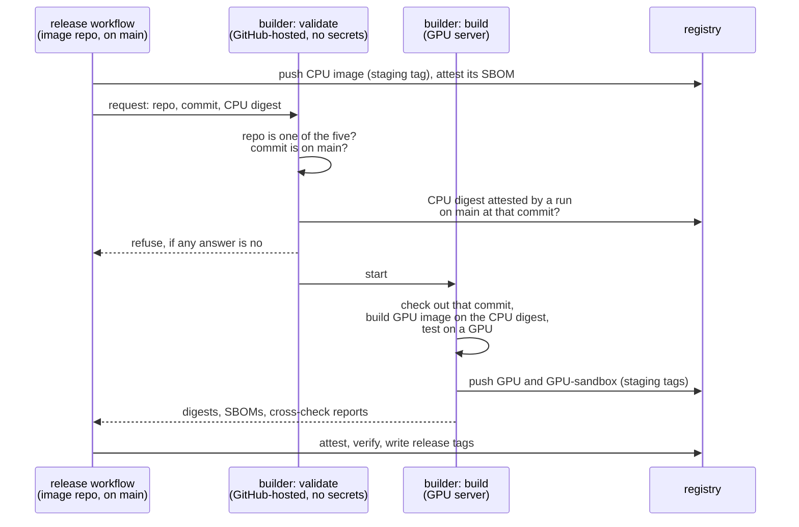

# GPU builds

The `gpu` variant is tested on a real NVIDIA GPU before it is published: the
test loads the CUDA libraries, runs a computation on the GPU, and starts the
application. `gpu-sandbox` is built on that tested image and gets the sandbox
lockdown and start-up test, which does not use a GPU. GitHub's hosted runners
have no GPU, so these two variants are built on a GPU server operated for
MESA at CyVerse, through a **self-hosted runner**.

> **Status, 2026-11-14.** The release workflow's request for a GPU build is
> written and tested with stand-ins. The builder workflow is written, and
> its check of the CPU image's attestation was tried by hand against a real
> image (it refused one built from a branch), but the workflow itself has
> never run. The runner is installed on the GPU server but not switched on
> yet, so this path has not run end to end. Until it has, the rolling `gpu`
> tags are built and tested by a maintainer on the same server.

## Why there is a separate, private repository

A self-hosted runner executes whatever a workflow tells it to. If it served
a public repository, a pull request from anyone could contain a workflow
that runs on it. GitHub advises against self-hosted runners on public
repositories for that reason.

The image repos are public. So the runner is registered to exactly one
**private** repository, `idss-mesa/mesa-gpu-builder`, which holds a single
workflow. The public repos cannot address the runner at all. They can only
*ask* the builder for a build, and the builder decides whether to do it.

## What the builder accepts

A request names an image repo, a commit, and the digest of a CPU image. The
first job of the builder workflow runs on a GitHub-hosted runner, has no
secrets, and refuses the request unless all of this holds:

1. The repo is one of the five image repos.
2. The commit is on that repo's `main`.
3. The CPU image at that digest carries an SBOM attestation signed by the
   shared release workflow, in a run for that repo, **on `main`**, **at
   that commit**.

The third check is what ties the *image* to reviewed code, not just the
build scripts. The signing certificate is issued by Sigstore from an
identity token that GitHub gives only to a running workflow. It states the
repository, branch and commit, so it cannot be obtained by pushing an image
to the registry or by running a workflow on another branch. And the release
workflow only attests the image it built and tested itself.

Only then does the job on the GPU server start. It checks out the requested
commit of the image repo and runs that repo's own `ci/mesa-ci.sh` (`build`,
`test`, `push`, `sbom`) for `gpu` and then `gpu-sandbox`. It pushes both
under staging tags and hands the digests, SBOMs and reports back. The
release workflow, not the builder, writes the release tags.

## Who can make the GPU server run code

| Who | Can they? |
|---|---|
| Anyone opening a pull request from a fork | No |
| Someone with write access to an image repo, pushing a branch | No. Asking the builder needs a key that only runs on `main` can read, and the builder builds only `main` |
| A pull request merged to `main` of an image repo | Yes. That is the code the builder is for. `main` only changes through pull requests that a second account approved or that an organisation owner merged ([GitHub Apps and access](github-apps-and-access.md#branch-rules)) |
| The few administrators of the builder repository | Yes |

## How the runner is kept contained

- It runs as a dedicated account with no administrative rights on the
  server, using **rootless Docker**: the container engine itself has no
  root privileges.
- It is **ephemeral**. A supervisor registers a fresh runner for one job
  only; when the job ends, the account's home directory, containers, images
  and temporary files are wiped and rebuilt from a read-only template
  before the next job. Nothing one job writes reaches the next.
- It needs no inbound connection: the runner opens no port to the network
  and only connects outwards, to GitHub. The builds it runs also reach the
  registry and whatever the image's Dockerfile and tests download from
  (package archives, download servers, GitHub releases). Outbound traffic
  is not otherwise restricted.
- The registry credentials exist on the server only for the length of a
  job.

## What this means in practice

- All five image repos share one runner that takes one job at a time. A
  release waits up to 200 minutes for its GPU build, queueing included; if
  that runs out, re-running the failed job asks again.
- If a release run is cancelled or its GPU job fails, it cancels the build
  it asked for.
- Pull requests do not build GPU variants. A change to `gpu/` is checked
  statically in the pull request (its lock files parse, its Dockerfile is
  linted) and built for real at the next rebuild of the rolling `gpu` tag
  or the next release.

The accounts and keys involved are described in
[GitHub Apps and access](github-apps-and-access.md).
