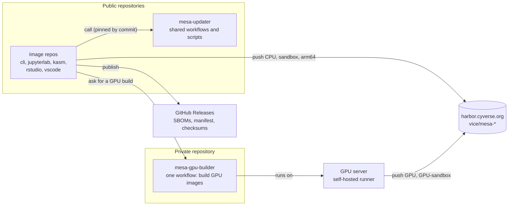

# Overview

This page describes the design. Today
[idss-mesa/cli](https://github.com/idss-mesa/cli) is the only image repo
converted to it (lock files, `VERSION`, a copy of the shared `ci/` files, the
shared pull-request check and release). The other four still build from
their Dockerfiles with the older workflows. See
[where things stand](README.md#where-things-stand).

## The images

Five image repositories each publish one application image to the CyVerse
registry, `harbor.cyverse.org`, in the project `vice`:

| Repository | Image | What it is |
|---|---|---|
| [idss-mesa/cli](https://github.com/idss-mesa/cli) | `harbor.cyverse.org/vice/mesa-cli` | A terminal in the browser (ttyd) with the MESA command-line tools |
| [idss-mesa/jupyterlab](https://github.com/idss-mesa/jupyterlab) | `harbor.cyverse.org/vice/mesa-jupyterlab` | JupyterLab |
| [idss-mesa/kasm](https://github.com/idss-mesa/kasm) | `harbor.cyverse.org/vice/mesa-kasm` | A Linux desktop in the browser |
| [idss-mesa/rstudio](https://github.com/idss-mesa/rstudio) | `harbor.cyverse.org/vice/mesa-rstudio` | RStudio Server |
| [idss-mesa/vscode](https://github.com/idss-mesa/vscode) | `harbor.cyverse.org/vice/mesa-vscode` | VS Code in the browser (code-server) |

Each image comes in up to four **variants**, built as layers on one another:

| Variant | Built on | What it adds | Platforms |
|---|---|---|---|
| `cpu` | a pinned upstream base image | the application and the MESA tools | amd64 (cli also arm64) |
| `sandbox` | `cpu` | nothing; it *removes* `sudo` and every other way to become root, for running AI agents | amd64 |
| `gpu` | `cpu` | NVIDIA CUDA libraries and GPU Python packages | amd64 |
| `gpu-sandbox` | `gpu` | the same lockdown as `sandbox` | amd64 |

## Two kinds of tags

| Kind | Tags | Meaning |
|---|---|---|
| **Rolling** | `latest`, `sandbox`, `gpu`, `gpu-sandbox` (cli also `arm64`) | Rebuilt regularly. The tag moves; what you pull today may differ from last week |
| **Release** | `v2.0.0`, `v2.0.0-sandbox`, `v2.0.0-gpu`, `v2.0.0-gpu-sandbox` (cli also `v2.0.0-arm64`) | Built once, from lock files, with a signed software bill of materials (SBOM). The pipeline never moves the tag |

Each repo has its own version number (the file `VERSION`), following
[semantic versioning](https://semver.org). The first release of each repo is
`v2.0.0`. The version describes the MESA image, not the application inside
it: the versions of JupyterLab, RStudio and everything else are in the SBOM.

Use a release tag when a result must be reproducible or auditable. Use a
rolling tag to follow the latest build. Today the rolling tags of a converted
repo (cli) are rebuilt from the lock files committed in git, so between lock
updates only Ubuntu packages change; regenerating the locks at each rolling
build is planned ([Workflows](workflows.md#rolling-builds)).

## The repositories

| Repository | Visibility | Role |
|---|---|---|
| The five image repos | public | Dockerfiles and tests; once converted (cli today) also lock files and thin workflow files that call the shared workflows |
| [idss-mesa/mesa-updater](https://github.com/idss-mesa/mesa-updater) (this one) | public | The reusable workflows and the scripts they run (`ci/`), with their tests. Each converted image repo keeps a byte-identical copy of `ci/` |
| idss-mesa/mesa-gpu-builder | private | The only repository the GPU server's runner serves. It builds GPU images when an image repo asks, after checking the request |

Most of the work runs on GitHub's hosted runners. Only the GPU variants need
a machine with a GPU, because their test runs real GPU code. See
[GPU builds](gpu-builds.md) for why that machine is kept behind a private
repository.

## The rules the automation follows

These are the properties the workflows are built to guarantee. The other
pages explain how.

1. **A release is built only from what is in git.** Every input is named by
   a version and a checksum in a lock file or the Dockerfile
   ([Images, locks and SBOMs](images-and-locks.md)). Two stated exceptions:
   packages from the NVIDIA apt repository are pinned by exact version (the
   repository's signing keyring by checksum), and the Ubuntu package archive
   is recorded but not pinned.
2. **No release image is published before it is tested.** Each variant is
   built, started and tested; only then is it pushed, and at first only
   under a *staging* tag that nobody pulls. (Today's rolling `latest` builds
   are pushed without a test; the planned rolling workflow will follow the
   same rule.)
3. **Every release image has an SBOM that was checked against the image.**
   The lock files say what should be inside; a scanner reports what is
   inside; the build fails if a locked package is missing or has another
   version.
4. **Tags come last.** The `vX.Y.Z` tags are written only after every variant
   passed and every SBOM was signed and verified. A release that fails
   before its last job (`publish`) leaves no release tag behind. A failure
   inside `publish` can leave some tags written; re-running the failed job
   finishes the same release
   ([Releasing a version](releasing.md#when-a-release-fails)).
5. **A release tag is never rebuilt.** Changing an image means a new
   version.
6. **Provenance can be checked by anyone.** Each SBOM is signed with a
   short-lived certificate that Sigstore issues from the identity token
   GitHub gives the running workflow; it names the repository, the branch
   and the commit ([Verifying an image](verifying-an-image.md)).
7. **A person decides when to release.** Automation builds what was merged,
   and the planned daily update check will only open pull requests. Nothing
   is released until a person merges a change to `VERSION` or starts the
   release by hand.
8. **Every step is a script that also runs by hand.** The workflows do their
   work by calling scripts in `ci/` (`mesa-ci.sh`, `release.py`,
   `attach_sbom.sh`, `gpu_request.sh`, `install-tools.sh`), so a maintainer
   can run the same build, test and SBOM commands on their own machine
   ([Releasing a version](releasing.md#doing-it-by-hand)).

## The life of a change

1. Someone opens a pull request in a converted image repo. The
   [pull-request check](workflows.md#pull-request-check) builds the CPU image
   on amd64 and arm64 and the sandbox image, tests them, and cross-checks
   each against the lock files. It uses no secrets and pushes nothing.
2. The pull request is reviewed and merged to `main`. `main` only changes
   through pull requests that a second account approved or that an
   organisation owner merged
   ([GitHub Apps and access](github-apps-and-access.md#branch-rules)).
3. The merge rebuilds `latest` (and cli's `arm64`) when it touched the
   image. The other rolling tags follow at their next rebuild
   ([Workflows](workflows.md#rolling-builds)).
4. If the pull request raised `VERSION`, merging it starts the
   [release](releasing.md) of that version.
