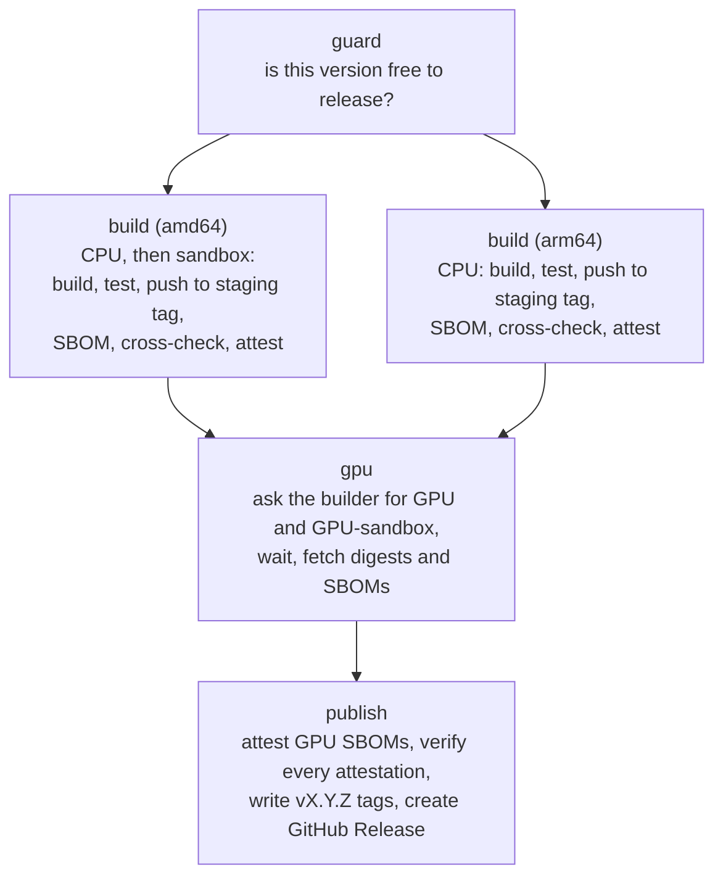

# Workflows

All automation is GitHub Actions. The logic lives in two **reusable
workflows** in this repo; an image repo's own workflow files only say when to
call them, pinned to an exact commit of this repo.

| Workflow | Lives in | Starts when | Runs on | Publishes |
|---|---|---|---|---|
| [Pull-request check](#pull-request-check) | `mesa-pr.yml` here, called by `pr.yml` | a pull request is opened or updated | GitHub-hosted | nothing |
| [Release](#release) | `mesa-release.yml` here, called by `release.yml` | a change to `VERSION` reaches `main`, or by hand | GitHub-hosted, plus the GPU builder | `vX.Y.Z*` tags, attestations, a GitHub Release |
| [GPU build](gpu-builds.md) | `build.yml` in the private builder repo | a release asks for it | GitHub-hosted check, then the GPU server | staging tags for the GPU images |
| [Rolling builds](#rolling-builds) | `harbor.yml` in each image repo | weekly, on most merges to `main`, or by hand | GitHub-hosted | `latest` (cli also `arm64`) |
| [Security scan](#security-scan) | `security.yml` in each image repo | pull requests; weekly | GitHub-hosted | nothing (reports) |
| [Tests of the shared scripts](#tests-of-the-shared-scripts) | `ci.yml` here | pull requests and merges in this repo | GitHub-hosted | nothing |
| Daily update check | planned | daily | GitHub-hosted | a pull request |

The pull-request check and the release are in use in
[idss-mesa/cli](https://github.com/idss-mesa/cli). The other four image
repos have the rolling build and the security scan, and get the rest when
they are converted to lock files.

## Pull-request check

`mesa-pr.yml`. It needs no secrets and pushes nothing, so it is safe for
pull requests from forks.

| Job | Runner | Steps |
|---|---|---|
| `check` | `ubuntu-24.04` | `ci/mesa-ci.sh check`: the shared `ci/` files are unchanged, `VERSION` is `X.Y.Z`, every lock file and pin parses for every variant and architecture, and, if `VERSION` is already released, the image's files are those of that release |
| `build` (amd64) | `ubuntu-24.04` | CPU image: build, test, SBOM and cross-check. Then the sandbox image, built on that CPU image: build, test, SBOM and cross-check |
| `build` (arm64) | `ubuntu-24.04-arm` | CPU image: build, test, SBOM and cross-check |

A pull request fails when a locked package is missing from the image or has
another version. The SBOMs and cross-check reports are kept as run
artifacts for 14 days.

For cli the amd64 job takes about 15 to 20 minutes and the arm64 job about
7. GPU variants are not built here: no GPU runner can be reached from a
pull request, by design.

## Release

`mesa-release.yml`. [Releasing a version](releasing.md) is the guide for
people; this is what the jobs do.

`gpu` starts only when both builds passed. In a test run with the GPU
variants turned off, `publish` follows the builds directly.

| Job | What it does | What it may touch |
|---|---|---|
| `guard` | Static checks, then `release.py guard`: no tag of this version exists in the registry, no GitHub Release, no git tag. If the version is already fully released the run ends green and does nothing | reads only |
| `build` | Per architecture: `ci/mesa-ci.sh build`, `test`, `push`, `sbom` for the CPU image, then `ci/attach_sbom.sh` signs its SBOM. On amd64 the same for the sandbox image, built on the pushed CPU digest | registry (staging tags), signing |
| `gpu` | `ci/gpu_request.sh` asks the builder repo for a build on the staged CPU digest, waits (up to 200 minutes, queueing included), downloads the result. Cancels the builder run if this job fails or is cancelled | the builder repo's Actions, through a key only runs on `main` can read |
| `publish` | `release.py publish`: checks everything staged, signs the GPU SBOMs, verifies every attestation, then writes the tags and creates the GitHub Release | registry (release tags), signing, GitHub Release |

Properties worth knowing:

- **Staging tags.** A built image is pushed as
  `stage-<run id>-<variant>-<arch>`. The digest recorded for it is the one
  Docker reports for that push, and only if the registry's manifest is the
  image that was just built and tested. The tag is never read back, because
  a tag can be moved by anyone with push access.
- **Each variant builds on the staged digest below it**, not on a tag:
  sandbox and gpu on the CPU digest, gpu-sandbox on the GPU digest.
  `publish` checks this again from the images' layers.
- **`publish` writes nothing until everything checks out**: each SBOM names
  the right image, digest, version, variant, platform and commit; each
  cross-check passed; each digest is in the registry for the right
  platform; each release tag is free or already points at that digest.
- **Re-running failed jobs finishes the same release.** Every step of
  `publish` first looks at what is already there.
- **Permissions.** The workflow starts with no permissions. `build` and
  `publish` get an identity token for signing; only `publish` may write to
  the repository (the GitHub Release and its git tag).
- **One release at a time per repo.** Later runs wait in line.

A **test run** exercises the whole workflow without touching real tags: see
[Releasing a version](releasing.md#test-runs).

## Rolling builds

Today, in every image repo:

- `harbor.yml` builds the CPU image and pushes `latest` (in cli also
  `arm64`, on an arm64 runner) every Sunday at 00:00 UTC, by hand, and on
  merges to `main`: in jupyterlab, kasm, rstudio and vscode those that
  change `latest/` or `harbor.yml` itself; in cli every merge except one
  that changes only `gpu/`, `harbor-gpu.yml`, `Makefile`, `README.md` or
  `.gitignore`. So in cli a merge that changes only `ci/`, `sandbox/`,
  `VERSION` or another workflow file also rebuilds `latest` and `arm64`.
  The image is pushed as soon as it builds, without a test.
- `gpu`, `sandbox` and `gpu-sandbox` are rebuilt by a maintainer on the GPU
  server with the repo's `make` targets: build, run the GPU and sandbox
  tests, and push only if they pass.
- `harbor-gpu.yml` and `harbor-sandbox.yml` are hand-started alternatives
  that build and push without the GPU test.

**Planned:** one shared workflow, `mesa-rolling.yml`, that replaces these
three files. Weekly, it regenerates the lock files in its workspace
(committing nothing), builds all variants with the same steps as a release
(the GPU ones through the builder), tests them, and moves the rolling tags
only when every variant passed. It will also check after each merge that an
image change came with a new `VERSION`.

## Security scan

`security.yml` in each image repo:

- on every pull request, [hadolint](https://github.com/hadolint/hadolint)
  lints the Dockerfiles;
- every Sunday at 06:00 UTC (six hours after the rolling build) and by hand,
  [Trivy](https://github.com/aquasecurity/trivy) scans the published
  images.

Both report only; neither blocks a merge.

## Tests of the shared scripts

`ci.yml` in this repo runs on every pull request and merge here: the unit
tests under `tests/` on Python 3.10 and 3.13, `shellcheck` on the shell
scripts, and a check that `ci/SHARED.sha256` matches the files. The tests
use stand-ins for the registry, cosign, Docker and GitHub, so they need no
network and no credentials.

## Daily update check (planned)

A daily job per image repo that looks for newer versions of every pinned
input (base image digests, the sources listed in `ci/pins.tsv`, the package
locks) and for newly published vulnerabilities in the last release's SBOM.
When it finds something it regenerates the locks, raises the patch number
in `VERSION`, and opens or updates **one pull request**. New upstream
releases are held back a few days before they are proposed.

The pull request is opened with the `mesa-updater` GitHub App, so the
pull-request check runs on it like on any other
([GitHub Apps and access](github-apps-and-access.md)). Nothing is released
until a person merges it.

## How the workflows are kept honest

- **Pinned by commit.** Image repos call the reusable workflows as
  `…/mesa-pr.yml@<40-character commit>`. Third-party actions in the two
  shared workflows, in `ci.yml` and in the builder's workflow are pinned the
  same way. The `harbor*.yml` and `security.yml` files in the image repos
  still name their actions by version tag (for example
  `docker/build-push-action@v6`); only the Trivy action there is pinned by
  commit. The command-line tools the scripts use (syft, cosign, oras,
  crane, uv, grype) are downloaded by `ci/install-tools.sh` and verified
  against checksums in `ci/tools.lock`.
- **Shared files cannot drift.** Each image repo's `ci/` is a copy of this
  repo's, made with `./sync.sh <image repo>`. `ci/SHARED.sha256` lists the
  checksum of every shared file, and `ci/mesa-ci.sh check` fails if one was
  edited in place.
- **Changing a shared script** therefore takes two pull requests: one here,
  and one in each image repo that copies the files and moves the pinned
  commit. The second one runs the new code on real images before it is
  merged.
